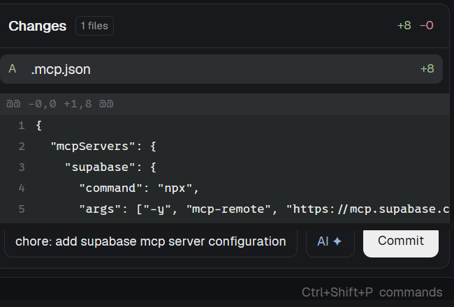

# Changes AI for Herdr Desktop



A drop-in clone of Herdr Desktop's **Changes** panel with an **AI ✦** button
beside **Commit**. Click it and the panel asks the AI provider you configured
to draft a commit message from the uncommitted changes, then puts the draft in
the message field. It never stages or commits: you review it, edit it if you
want, and press **Commit** yourself.

## What it does

- Shows the focused pane's repository: changed files, per-file diffs and
  line counts, like the shipped **Changes** panel.
- **AI ✦** builds a prompt from the branch, recent commit subjects, changed
  files, the full diff and short excerpts of untracked files.
- Fills the message field with the draft. Nothing else happens until you
  press **Commit**.
- Supports Conventional Commits (`feat(scope): subject`) or a plain style, and
  any language for the message.
- Reads `config.json` on every click, so changing provider, model or language
  applies without restarting Herdr.
- Works with a coding-agent CLI you already use (no key in this mod) or with a
  direct HTTP API where you put your own key in `config.json`.
- Keeps the prompt under the Windows command-line limit, so long diffs do not
  fail with an "argument list too long" error.
- Errors (missing key, bad model, timeout, invalid credential) appear in red
  under the diff; the panel keeps working.

## Requirements

- [Herdr Desktop](https://herdr.dev) with mod support.
- Git on `PATH`.
- At least one AI provider:
  - an installed and logged-in coding-agent CLI, or
  - an API key for DeepSeek or OpenCode Go.

## AI providers

### 1. Coding-agent CLI (recommended; no key in this mod)

The CLI keeps its own login. `"provider": "auto"` tries these commands in
order and uses the first one installed:

| Provider | Command it runs |
|---|---|
| `opencode` | `opencode run [--model MODEL] PROMPT` |
| `claude` | `claude -p PROMPT` |
| `copilot` | `copilot -p PROMPT [--model MODEL]` |
| `codex` | `codex exec [--model MODEL] PROMPT` |
| `gemini` | `gemini -p PROMPT [-m MODEL]` |

Set `provider` to one of those names to force it. `model` is passed to the
CLI; leave it empty to use the CLI's default.

Examples with OpenCode:

```json
{ "provider": "opencode", "model": "opencode-go/deepseek-v4.1-flash" }
```

```json
{ "provider": "opencode", "model": "cline-pass/cline-pass/deepseek-v4.1-flash" }
```

Use the exact id from `opencode models`. OpenCode stores the credentials, so
`api_key` stays empty.

### 2. Direct API (your key goes in `config.json`)

These endpoints are called over HTTPS by the panel itself:

| `provider` | Endpoint | Default model | Get a key |
|---|---|---|---|
| `deepseek` | `https://api.deepseek.com` | `deepseek-flash` | [platform.deepseek.com/api_keys](https://platform.deepseek.com/api_keys) |
| `opencode-go` | `https://opencode.ai/inference/go/openai/v1` | `deepseek-v4.1-flash` | [opencode.ai/console](https://opencode.ai/console) |

The key goes in the **`api_key`** field of the installed mod's `config.json`:

```json
{
  "provider": "opencode-go",
  "model": "deepseek-v4.1-flash",
  "api_key": "sk-...",
  "language": "English",
  "style": "conventional"
}
```

```json
{
  "provider": "deepseek",
  "model": "deepseek-flash",
  "api_key": "sk-..."
}
```

DeepSeek's API calls V4.1 Flash `deepseek-flash`; `deepseek-v4-pro` is the
larger model. OpenCode Go also exposes `deepseek-v4-pro` and many other models
at the same endpoint.

> `config.json` is listed in `.gitignore` and never belongs in Git. Commit
> only `config.example.json`.

## Configuration

Location of the **installed** copy (not the Git checkout):

- Windows: `%USERPROFILE%\.config\herdr-app\mods\changes-ai\config.json`
- macOS / Linux: `~/.config/herdr-app/mods/changes-ai/config.json`

Start from `config.example.json`:

```json
{
  "provider": "auto",
  "model": "",
  "api_key": "",
  "base_url": "",
  "language": "English",
  "style": "conventional",
  "max_diff_chars": 16000,
  "max_output_tokens": 1024,
  "timeout_ms": 180000
}
```

| Field | Meaning |
|---|---|
| `provider` | `auto`, `opencode`, `claude`, `copilot`, `codex`, `gemini`, `deepseek` or `opencode-go`. |
| `model` | CLI model id or API model id. Empty uses the provider's default. |
| `api_key` | Only for `deepseek` and `opencode-go`. Leave empty for CLIs. |
| `base_url` | Optional API base override, for a proxy. The direct providers know their own. |
| `language` | Language of the generated message, e.g. `English` or `Spanish`. |
| `style` | `conventional` (`feat(auth): add login`) or `plain`. |
| `max_diff_chars` | How much diff to send to a CLI. Kept below the Windows argv limit. |
| `max_output_tokens` | Reply budget for the direct APIs. |
| `timeout_ms` | How long to wait, clamped to 15 seconds–10 minutes. |

The panel follows the focused pane. Focus a terminal inside a Git repository
and the panel shows that repository; when the focused pane is outside Git it
says **Not a git repository**.

## Compatibility

- **Tested on:** Windows 11 ARM64 with Herdr Desktop 0.1.21, PowerShell 7,
  Git for Windows, and the OpenCode CLI. Both the CLI path and the direct
  DeepSeek-style HTTP path were exercised.
- **Operating system:** the mod is plain JavaScript on Herdr's gpui-kit and
  uses only Herdr APIs (`exec`, `readTextFile`, `fetch`, `watchFolder`). There
  is no native code, no installer and no OS-specific shell syntax, so macOS
  and Linux should work unchanged. The author has not tested those systems;
  the practical differences would be which CLIs are installed and their flags,
  not the panel itself.
- **CPU:** no binaries are shipped, so x64, ARM64 and Apple Silicon behave the
  same; only Herdr and the provider CLI care about the CPU.
- **Windows argv limit:** prompts for CLIs are clamped to 28,000 characters and
  diffs to 16,000 by default, below the ~32,767-character Windows limit. On
  macOS and Linux the same clamp is harmless.
- **Remote spaces:** the repository is read on the machine that owns the pane.
  Direct API calls are made from the machine running Herdr.

## Install step by step

Herdr Desktop has **no installer for mods**. `herdr plugin install` belongs to
the Herdr TUI (`herdr-plugin.toml`) and does not install this. A mod is just a
folder, so installing means copying it into Herdr's mods directory and pointing
a layout at it.

### Windows

1. Clone the repository somewhere you keep projects:

   ```powershell
   git clone git@github.com:hershey1990/herdr-git-changes-ai.git "$env:USERPROFILE\Develop\herdr-changes-ai"
   ```

2. Copy the mod into Herdr's mods folder. Keep the folder name `changes-ai`,
   because the layout references it by that name:

   ```powershell
   $src = "$env:USERPROFILE\Develop\herdr-changes-ai"
   $mod = "$env:USERPROFILE\.config\herdr-app\mods\changes-ai"
   New-Item -ItemType Directory -Force $mod | Out-Null
   Copy-Item "$src\main.js","$src\mod.json","$src\changes.svg","$src\README.md" $mod -Force
   ```

   Do not copy `config.json` over an existing one when updating.

3. Create your configuration and edit it:

   ```powershell
   Copy-Item "$mod\config.example.json" "$mod\config.json"
   notepad "$mod\config.json"
   ```

   Pick a provider and model. For a CLI, leave `api_key` empty. For
   `deepseek` or `opencode-go`, paste your key into `api_key`.

4. Point a layout at the panel. If you already have a personal layout, change
   its Changes block to:

   ```json
   { "id": "changes", "type": "block", "content": { "mod": "changes-ai" } }
   ```

   If you do not have one, copy the included example. It is a full clone of
   Herdr's `main` layout with the panel visible and showing this mod:

   ```powershell
   $layouts = "$env:USERPROFILE\.config\herdr-app\layouts"
   if (Test-Path "$layouts\main-plus.json") { Copy-Item "$layouts\main-plus.json" "$layouts\main-plus.backup.json" }
   Copy-Item "$env:USERPROFILE\Develop\herdr-changes-ai\examples\main-plus.json" "$layouts\main-plus.json" -Force
   ```

5. Let Herdr load and check the mod:

   ```powershell
   herdr-app check "$mod"
   herdr-app do layout.switch --name main-plus
   ```

   If `herdr-app` is not on `PATH`, use `Ctrl+Shift+L` in the app to switch
   layouts, or restart Herdr.

6. Focus a terminal inside a Git repository with uncommitted changes, click
   **AI ✦**, review the draft and press **Commit**.

### macOS / Linux

The same steps with Unix paths:

```sh
git clone git@github.com:hershey1990/herdr-git-changes-ai.git ~/Develop/herdr-changes-ai

mod="$HOME/.config/herdr-app/mods/changes-ai"
mkdir -p "$mod"
cp ~/Develop/herdr-changes-ai/main.js \
   ~/Develop/herdr-changes-ai/mod.json \
   ~/Develop/herdr-changes-ai/changes.svg \
   ~/Develop/herdr-changes-ai/README.md "$mod/"

cp "$mod/config.example.json" "$mod/config.json"
${EDITOR:-nano} "$mod/config.json"

mkdir -p "$HOME/.config/herdr-app/layouts"
cp ~/Develop/herdr-changes-ai/examples/main-plus.json "$HOME/.config/herdr-app/layouts/main-plus.json"

herdr-app check "$mod"
herdr-app do layout.switch --name main-plus
```

### Updating

Copy `main.js` (and any changed assets) into the installed folder again,
keeping your `config.json`. Editing the Git checkout does **not** affect the
running app, because Herdr loads the copy in `mods/`.

## Usage

- Select a file in the list to see its diff.
- Click **AI ✦**. While it works, the button shows `AI ·`, `AI ··`, `AI ···`.
- The draft replaces an empty message field. If you had typed something, it is
  left untouched.
- **Commit** runs `git add -A` and `git commit -m "<message>"` in the shown
  repository. Stage or review by hand first if you want a partial commit.
- Switching to another space or pane resets the draft, like the shipped panel.

## How it works

1. Resolves the repository with `git rev-parse --show-toplevel` in the focused
   pane's folder (or on its machine).
2. Collects `git status`, `git diff`, the branch and the last 12 commit
   subjects. Untracked files are read as short excerpts because they have no
   diff.
3. Builds a prompt that asks for a Conventional Commit (or plain) message in
   the configured language.
4. Runs the configured CLI with `exec`, or POSTs to the direct API with
   `fetch`.
5. Strips code fences, quotes and preambles from the reply and fills the
   message field. It never commits.

## Troubleshooting

| Symptom | Fix |
|---|---|
| **Not a git repository** | Focus a terminal whose working directory is inside a repository. |
| **No AI CLI found** | Install `opencode`, `claude`, `copilot`, `codex` or `gemini`, or set `deepseek` / `opencode-go` with an `api_key`. |
| **Unknown provider** | Use one of the names in the [AI providers](#ai-providers) tables. |
| **Invalid credential** from OpenCode Go | The stored credential expired or the plan is inactive. Run `opencode auth login`, select OpenCode Go, and check the subscription at opencode.ai/console. |
| **Model unavailable** | List ids with `opencode models` and copy the exact `provider/model` string. |
| **401 / 403** from a direct API | Check `api_key`. Keys are per provider and per account. |
| **AI failed … timed out** | Raise `timeout_ms`, or use a smaller model. |
| The panel is missing | The layout's panel is hidden: `herdr-app do layout.show --id panel`. Check that the layout's Changes block uses `changes-ai`. |
| A save broke the mod | `herdr-app check "<mods>/changes-ai"` prints the error; Herdr keeps the last good build running. |

## Security and privacy

- `config.json` can hold an API key and is **gitignored**. Never commit it.
- The diff and untracked excerpts are sent only to the provider you choose:
  the CLI's backend, or the direct API over HTTPS.
- Untracked excerpts are capped (6 files, ~3,000 characters each, 4,000 total
  in the prompt) so a stray file does not travel in full.
- The AI only writes the message field. Staging and committing stay manual.
- This mod adds no telemetry of its own.

## Notes

- Herdr's shipped `changes` mod is read-only and replaced on every start, so
  this is a clone (`mod.json` records `cloned_from`). It is safe to edit.
- The panel ID stays `changes`; layouts and toggles that reference the
  original panel keep working.
- `gpui-kit.d.ts` and `jsconfig.json` are generated by Herdr and ignored.

## License

MIT. See [LICENSE](LICENSE).
