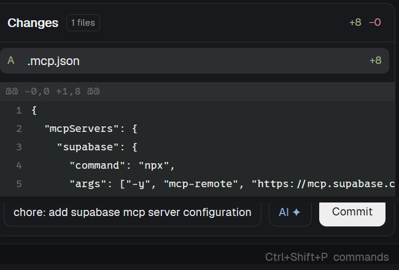

# Changes AI

Herdr Desktop's **Changes** panel with an **AI ✦** button beside **Commit**. The
panel lists the focused pane's uncommitted files with their diffs; clicking
**AI ✦** asks a coding-agent CLI or a direct API to draft a commit message and
puts the draft in the message field. It never stages or commits: the person
reviews the draft and presses **Commit** themselves.

## What you see

One panel on the `background` color, radius 10, 1px `border`, base type 13,
filling its block. Top to bottom:

- **Header**, 42px, 14px side padding, bottom border: `Changes` at 13px
  semibold, a file-count chip (5px/1px padding, radius 4, 10px, `muted`, 1px
  `border`, e.g. `3 files`), then on the right `+N` in `ansi2` and `−N` in
  `ansi1` at 11px, the sums of every file's added and deleted lines.
- **File list**, from 44px up to 12px + 28px per file (it grows with the list
  and then scrolls), bottom border. Each row is 28px, 8px side padding, 6px
  gap, radius 7: the status letter at 11px (`A` `ansi2`, `D` `ansi1`, `U`
  `ansi1`, `M` `blocked`), the folder in `dim` followed by the file name, then
  `+add` in `ansi2` and `−del` in `ansi1` at 11px when non-zero. The selected
  row is `selected`; the row under the pointer is `hover`. A vertical
  scrollbar sits on the right. At most 1,000 rows; past that a 11px `dim`
  line says `Showing the first 1,000 changed files`.
- **Diff**, the rest of the panel, monospace at the settings font family
  (default `JetBrains Mono`), 11px. Rows are 20px: a 30px right-aligned `dim`
  line-number column, then the text. Hunk headers (`@@`) are full-width on
  `raised` in `dim`; added lines are tinted `ansi2` at 9%, removed lines
  `ansi1` at 9%. Tabs are padded to the next 4-column stop, since a drawn tab
  is zero-width. Both a vertical and a horizontal scrollbar, and the content
  is a virtual list, so only visible rows draw. The diff width starts at 300
  and is `(longest row + 1) × 7 + 50`.
- **Message bar**, 10px padding, top border, 8px gap: the message input
  (flex, 32px, radius 8, 10px side padding, 12px text, `accent` border while
  focused, placeholder `Commit message`), the **AI ✦** button (32px, 10px
  side padding, radius 8, 1px border, `accent` text when enabled, `dim` when
  not; while running it cycles `AI ·`, `AI ··`, `AI ···` every 320ms with an
  `accent` border), and **Commit** (32px, 14px side padding, radius 8, `solid`
  background and `solid_foreground` text when enabled, `raised`/`dim` when
  not; `Committing…` while it runs).
- **Error/status line**, only when there is a note: 10px side padding, 8px
  bottom, 11px in `ansi1`, between the diff and the message bar.

Empty states draw in the file list at 8px padding in `dim`: `Loading changes…`,
`No uncommitted changes`, `No folder`, or the error text, most commonly
`Not a git repository`. With no file selected the diff says `Select a file to
view its changes` at 6px from the top in `dim`.

## How it behaves

- **Which repository**: the active space and focused pane. The folder is the
  pane's live `cwd`, else `focused().cwd`, else the space folder. When the
  focused terminal is a remote one (`focused().pane === null`) the machine
  comes from the terminal id's prefix (`host/...`), otherwise the space's
  `machine`. A change of folder or machine resets the panel: files, selection,
  diff, message, note and watcher.
- **Loading**: `git rev-parse --show-toplevel`, then
  `git status --porcelain=v1 -z --no-renames --untracked-files=all`,
  `git rev-parse --verify HEAD`, and `git diff HEAD --numstat -z --no-renames`
  (`diff --cached` plus `diff` when there is no HEAD yet). Reads pass
  `--no-optional-locks -c core.fsmonitor=false -c diff.autoRefreshIndex=false`
  so they write nothing under `.git`.
- **Staying live**: a 10-second `cx.timer.every` refresh, plus `watchFolder`
  on the repository root for local panes. Remote panes are not watched.
  Refreshes are skipped while loading, committing or generating.
- **Selecting a file** toggles its diff (clicking the open file closes it).
  The first file is opened automatically, unless the person closed the diff.
  An untracked or newly added file is drawn from its text as an all-added diff
  (`@@ -0,0 +1,N @@`), capped at 1,500 lines and 400,000 characters; a binary
  or unreadable file says so. Tracked files use
  `git diff HEAD --no-ext-diff --no-textconv --no-color -- <path>` (or
  `git diff` with no HEAD), from the first hunk.
- **AI ✦** is enabled only when there are files, a repository, and nothing is
  loading, committing or generating. A click captures the current message,
  reads `config.json`, then builds the prompt from the repository path, branch,
  the last 12 commit subjects, the changed-file list, the diff (at most
  `max_diff_chars`, default 16,000) and excerpts of up to 6 untracked files
  (3,000 characters each, 4,000 total). The whole prompt is clamped to 28,000
  characters.
- **Drafting**: the configured provider is used. A CLI runs in the repository
  folder (and on the pane's machine) with the arguments below; a direct API is
  POSTed from the machine running Herdr. The reply is stripped of ANSI, code
  fences, a leading `commit message:` or `Here is…` line, and wrapping quotes.
  It replaces the message only if the field is still what it was when the
  button was pressed, so typing during a run is never overwritten. Errors show
  in the note line and leave the panel working.
- **Providers** (`config.json`):
  - `opencode` → `opencode run [--model M] PROMPT`
  - `claude` → `claude -p PROMPT`
  - `copilot` → `copilot -p PROMPT [--model M]`
  - `codex` → `codex exec [--model M] PROMPT`
  - `gemini` → `gemini -p PROMPT [-m M]`
  - `auto` tries those five in that order with `--version` and takes the first
    that exits 0.
  - `deepseek` → `POST https://api.deepseek.com/chat/completions`, default
    model `deepseek-flash`, bearer `api_key`.
  - `opencode-go` → `POST
    https://opencode.ai/inference/go/openai/v1/chat/completions`, default model
    `deepseek-v4.1-flash`, bearer `api_key`, plus `x-opencode-session` with a
    per-window id.
  - `base_url` overrides the API base; `/chat/completions` is appended unless
    it is already there. The body is `{ model, messages: [{role: "user",
    content}], max_tokens, temperature: 0.3, stream: false }`.
- **Commit** runs `git add -A` then `git commit -m <message>` in the shown
  repository, clears the field, and refreshes. It does nothing while the
  message is empty or work is in flight.
- The message input submits on Enter. Escape while typing returns focus to the
  panel.

## Built from

- `mods/changes-ai/`: `main.js`, `mod.json`, `changes.svg`,
  `config.example.json`.
- `mod.json` is `{ "place": "none",
  "cloned_from": { "name": "changes", "version": "0.1.16" } }`: the panel does
  not dock by itself; a layout places it.
- A layout shows it with the panel block kept as id `changes`:
  `{ "id": "changes", "type": "block", "content": { "mod": "changes-ai" } }`.
- `main.js`: one default-exported `View`. Imports from `gpui-kit` (`View`,
  `div`), `gpui-base` (`v_flex`, `h_flex`, `InputState`, `Input`, `Scrollbar`,
  `v_virtual_list`) and `herdr` (`spaces`, `panes`, `focused`, `exec`,
  `readTextFile`, `watchFolder`, `theme`, `settings`, `appHome`). Uses the
  global `fetch`, `cx.spawn`, `cx.timer.every` and `cx.timer.after` (the
  timeout guard for HTTP), and `cx.notify`.
- `config.json` is read on every AI click from
  `<appHome>/mods/changes-ai/config.json`, merged over the defaults
  `{ provider: "auto", model: "", api_key: "", base_url: "", language:
  "English", style: "conventional", max_diff_chars: 16000,
  max_output_tokens: 1024, timeout_ms: 180000 }`. `config.example.json` is the
  same object with empty strings. `config.json` is gitignored.
- The prompt asks for Conventional Commits
  (`<type>(<optional scope>): <subject>`) or a plain summary and optional body,
  imperative, lowercase, no trailing period, 72-character subject, body
  wrapped at 72, in `language`, describing the actual diff.
- Programs: `git` and the chosen AI CLI, through `exec(..., { cwd, on })`.
  Direct APIs go through `fetch` from Herdr. No other programs, no files
  outside the repository and the installed mod folder.
- Colors and sizes come only from `theme()` (`background`, `border`,
  `foreground`, `muted`, `dim`, `raised`, `selected`, `hover`, `solid`,
  `solid_foreground`, `accent`, `ansi1`, `ansi2`, `blocked`) and
  `settings().font_family`.

## Watch out

- **`untracked` is already a string.** `buildPrompt` receives the joined
  excerpts; calling `untracked.join(...)` throws `TypeError: not a function`,
  and it only shows up when the repository has untracked files.
- Build the prompt by filtering out empty lines and joining, not by indexing a
  fixed array: the untracked section is conditional.
- `cx.spawn`'s callback gets an `AsyncContext`. `cx.timer.after` exists there
  and returns a cancelable `Task`; do not reach for `setTimeout`, which mods do
  not have.
- `exec` stops a command at 30 seconds unless `timeout` is passed. Git reads
  are fine; the AI call must pass its own `timeout` (clamped 15s–10min), and
  `fetch` has no built-in timeout, so the HTTP path needs the timer guard.
- A Windows argv is capped near 32,767 characters. Keep the prompt clamp
  (28,000) and the default diff (16,000) below it, or a large change fails to
  spawn the CLI at all.
- `opencode run` prints its model header on stderr and the message on stdout;
  take stdout. Some CLIs add a preamble or fences, so clean the reply before
  putting it in the field.
- `config.json` is read from the *installed* folder name. If the mod folder is
  renamed, that path must change too.
- The panel follows focus, so a remote pane's repository is read with `on`; a
  direct API call still leaves the local machine, not the remote one. Say so in
  the README.
- Diff rows must be rendered from numbered rows in a virtual list. A tab in
  drawn text is zero-width, so untab before drawing or columns collapse.
- The file list is capped at 1,000 entries to keep status parsing bounded.
  Untracked excerpts are capped at 6 files so a stray large file is not sent
  whole.
- Herdr regenerates `gpui-kit.d.ts` and `jsconfig.json` on every start; keep
  them out of Git. Herdr also replaces its shipped mods, so clone rather than
  edit `mods/changes/`; this panel keeps the block id `changes` but its own
  folder `mods/changes-ai/`.
- This mod is desktop-only. `herdr plugin install` belongs to the Herdr TUI and
  its `herdr-plugin.toml`; it does not place a desktop mod. Install by copying
  the folder and adding the layout block.

## Done when

- `herdr-app check mods/changes-ai` passes and `herdr-app status` reports no
  errors.
- With a layout that places the block as `changes` → `changes-ai`, the panel
  shows the focused repository's changed files, counts and the first file's
  diff; clicking another file shows its diff and clicking it again closes it.
- Focusing a terminal outside a Git repository shows `Not a git repository`,
  and focusing back restores the repository without a stale diff.
- Editing a file in a terminal updates the list within the refresh interval;
  a locally made change also appears through the folder watch.
- A repository with an untracked file shows it, opens its full content as
  added lines, and **AI ✦** still drafts a message (the regression that
  `untracked.join` caused).
- With no `config.json` or no provider installed, **AI ✦** shows a clear red
  note (`No AI CLI found…` or `Set "api_key"…`) and the panel keeps working.
- With `provider: "opencode"` and a logged-in model, **AI ✦** fills the message
  with a Conventional Commit subject for the actual diff, e.g.
  `docs(readme): add install section`, in the configured language.
- Typing in the field while the draft is being generated keeps the typed text.
- **Commit** stages everything and commits with the shown message, clears the
  field, and the file list becomes empty.
